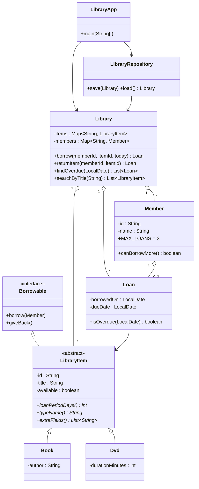

# Mini-Project: Library Management System

A console application that lends books and DVDs to members, enforces a 3-loan limit, reports overdue
items and saves everything to CSV files between runs.

## Build, test and run

```bash
cd mini_project
mkdir -p out
javac -d out $(find src test -name "*.java")

java -cp out library.LibraryTests        # 33 automated checks, exit code 1 on failure
java -cp out library.LibraryApp          # start the menu (uses the ./data folder)
java -cp out library.LibraryApp mydata   # or use a different data folder
```

The `data/` folder holds sample data (6 items, 3 members, 2 loans - one already overdue).
Choosing **0. Save and exit** rewrites `items.csv`, `members.csv` and `loans.csv`; the next start reloads them.
Delete the three files for an empty library.

## Requirement checklist

| Requirement                                                     | Where                                                        |
|-----------------------------------------------------------------|--------------------------------------------------------------|
| `Book`, `Member`, `Loan` with private fields, validation, `toString` | `Book`, `Member`, `Loan`                                |
| Abstract `LibraryItem`; `Book`/`Dvd` with own `loanPeriodDays()` | `LibraryItem` (abstract), `Book` = 21 days, `Dvd` = 7 days  |
| `Borrowable` interface with `borrow(Member)` and `giveBack()`    | `Borrowable`, implemented by `LibraryItem`                   |
| Custom exceptions, maximum 3 loans per member                    | `ItemNotAvailableException`, `MemberLimitExceededException`  |
| `Map<String, ...>` collections keyed by id                       | `Library` (`items`, `members`)                               |
| CSV persistence: save on exit, reload on start                   | `LibraryRepository`, `CsvUtil`                               |
| Menu: add item, register member, borrow, return, overdue, search | `LibraryApp` (search and overdue use streams in `Library`)   |

## Class diagram



## Design notes

- **Encapsulation:** all fields are private. `LibraryItem.setAvailable` is package-private, so only the
  library package can force availability (used when reloading saved loans).
- **Polymorphism:** `Loan` computes its due date from `item.loanPeriodDays()`; `Library` never checks the item type.
- **Exceptions:** `borrow` validates availability and the member limit *before* changing any state, so a
  rejected borrow leaves everything untouched. Missing ids raise `IllegalArgumentException`.
- **Persistence:** item availability is *derived* from `loans.csv` rather than stored, so the files cannot
  disagree. `CsvUtil` quotes fields so titles like `Head First Java, 3rd Edition` survive a round trip.
- **Testability:** dates are passed in (`borrow(..., today)`, `findOverdue(asOf)`) instead of calling
  `LocalDate.now()` inside the service, so overdue logic is tested without waiting. The menu lets you pick an
  "as of" date when listing overdue items.
